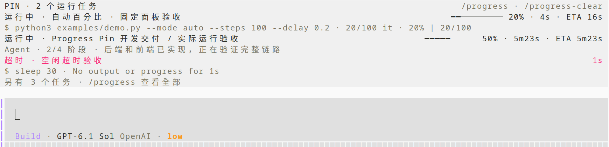

# OpenCode Progress Pin

## 这是什么

供 OpenCode Agent 使用的长任务进度插件：后台执行命令，并将实时进度固定在输入框上方，不随聊天记录滚走。



## 有什么用

- 一次调用启动后台任务，完成后自动通知 Agent，日志落盘。
- 有进度数据时显示百分比和预计剩余时间；未知进度只显示状态、阶段和耗时。
- 自动识别 tqdm、百分比和计数；支持 Python `progress(items)` 包装、自定义采集器和 Agent 手动汇报。
- 可选最大运行时间与空闲超时；支持取消任务，区分成功、失败、超时和中断。
- `/progress` 查看详情、日志或取消任务；`/progress-clear` 收起已结束任务。

工具参数与示例见 [使用说明](docs/usage.md)。

## 怎么安装

将仓库克隆到希望长期保存的位置，进入仓库后执行：

```sh
bun install --frozen-lockfile
bun run install-plugin
```

安装器全局注册后端和 TUI，保留其他配置。运行中的 OpenCode 支持热加载；没有可见任务时面板隐藏。源码目录需保留，安装使用软链接和本地路径。

若已启用 `opencode-terminal-progress`，安装器会替换其 CLI 注册，避免重复写入终端进度。

## 兼容什么

| 项目 | 支持情况 |
| --- | --- |
| OpenCode | V2，已在 **2.0.26** 实际验证；不支持 V1 |
| 系统 | **Linux**；优先 systemd 用户服务，否则使用独立后台进程；其他系统未验证 |
| 运行环境 | Bun；Python 包装器可选，需要 Python **3.10+**，无额外 Python 依赖 |
| 界面 | OpenCode TUI；固定面板不依赖终端进度协议，暂不包含 Desktop GUI 面板 |
| 终端进度指示 | Ghostty、WezTerm、iTerm2、Windows Terminal、可确认版本的 kitty **0.47+** |

OpenCode 2.0.26 的命令执行需要匹配的显式 `allow` 权限。后台任务可跨界面重载继续运行，系统重启后不会自动重跑。
